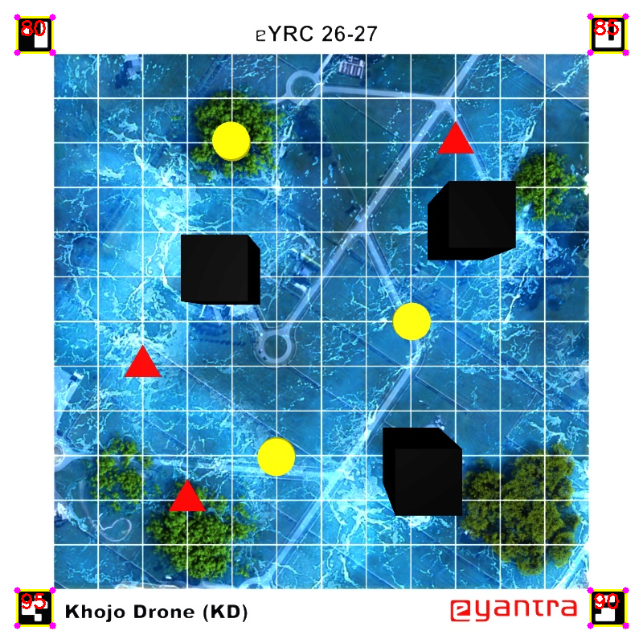
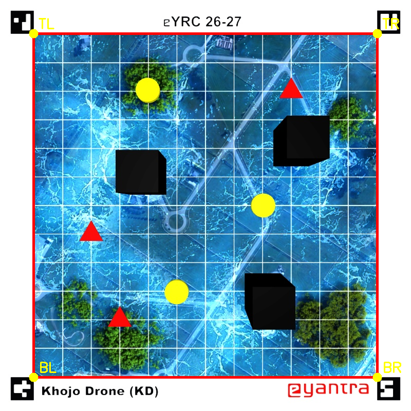
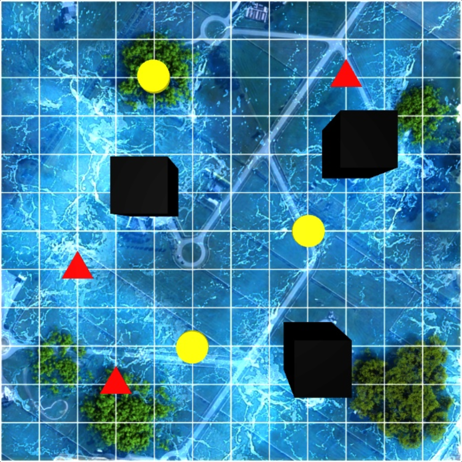
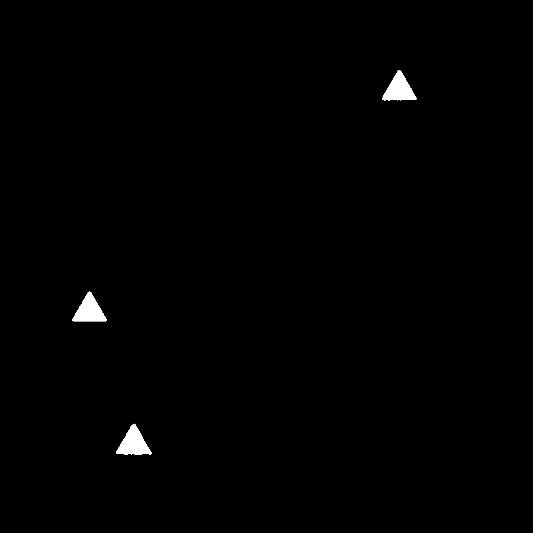
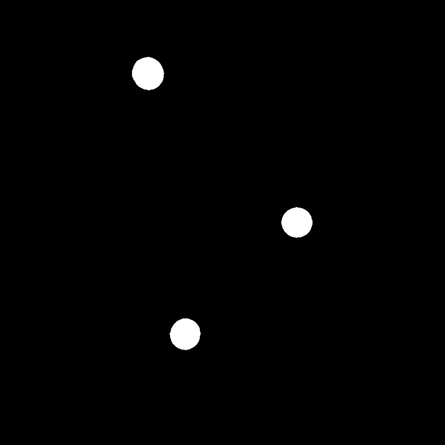
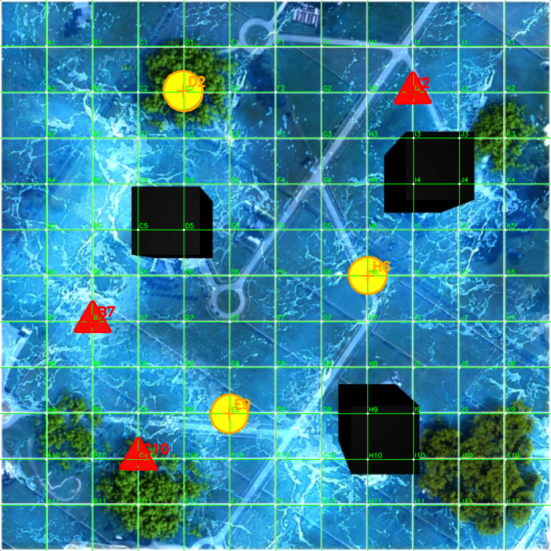
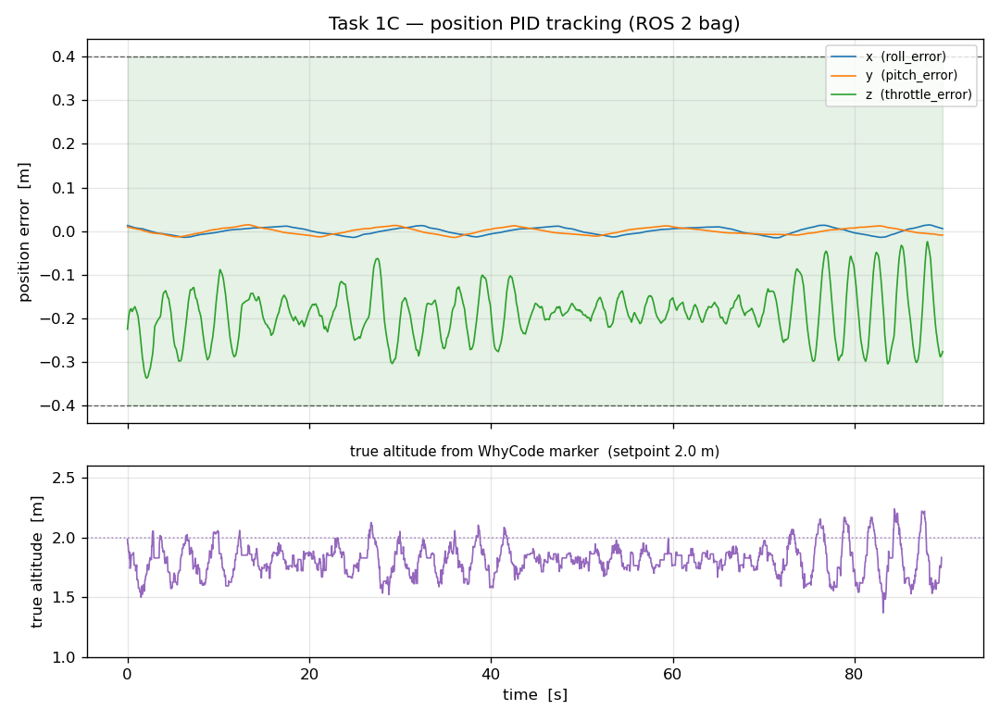
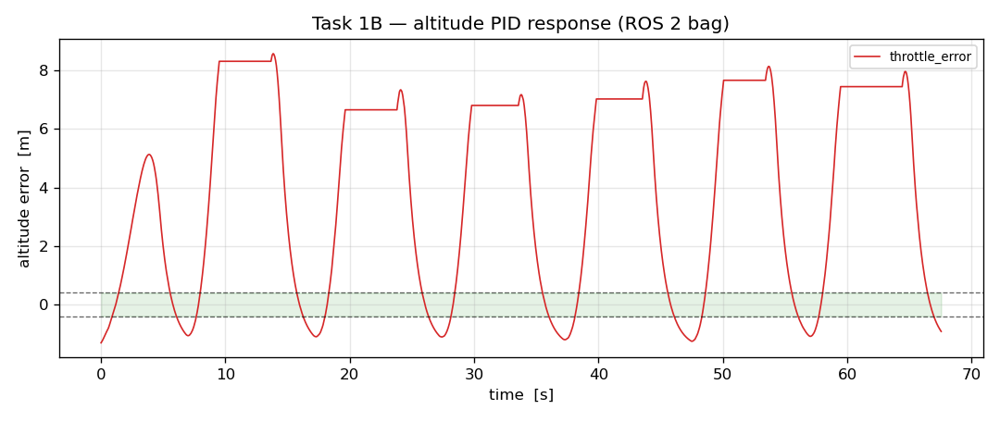

<div align="center">

# eYRC 2026–27 · Khoj-o-Drone Theme

### Stage 1 — Swift Pico

**Arena perception and autonomous flight control for a quadrotor, built on ROS 2 and MuJoCo.**

[](https://docs.ros.org/en/humble/)
[](https://www.python.org/)
[](https://opencv.org/)
[](LICENSE)

</div>

---

## Table of contents

1. [What this project does](#1-what-this-project-does)
2. [Technology used](#2-technology-used)
3. [Demo](#3-demo)
4. [Repository structure](#4-repository-structure)
5. [Installation and setup](#5-installation-and-setup)
6. [Usage](#6-usage)
7. [The three tasks](#7-the-three-tasks)
8. [Measured results](#8-measured-results)
9. [Testing](#9-testing)
10. [Documentation](#10-documentation)

---

## 1. What this project does

This repository contains the completed **Stage 1** work for the eYRC 2026–27
Khoj-o-Drone theme. The goal of Stage 1 is to make a simulated quadrotor
autonomously sense and control itself in a marked arena.

Three tasks were delivered:

| Task | Subject | What it does |
|---|---|---|
| **1A** | Arena perception | Finds the arena in an image, reconstructs its grid, and locates the survivors on it |
| **1B** | Altitude control | A PID controller that flies the drone to a target altitude and holds it |
| **1C** | Position control | A PID controller that flies the drone to a target position and holds it |

The interesting engineering is in the *joints* between them. Task 1C's
position loop is only possible because Task 1B established how this vehicle's
unusual sensor and its RC command interface actually behave — and both of those
turned out to be the opposite of what the code first suggested.

**Everything is derived from the simulator and the repository itself.** No
survivor location, no settling time and no performance figure in this
repository is hard-coded or invented; every one of them comes from a recorded
ROS 2 bag that is committed here for re-verification.

---

## 2. Technology used

| Layer | Technology |
|---|---|
| **Middleware** | ROS 2 Humble (DDS via Fast DDS) |
| **Simulation** | MuJoCo 3.9 (via the pre-built `mujoco_bridge`) |
| **Language** | Python 3.10 (controllers, image processing), C++ (ROS 2 nodes) |
| **Computer vision** | OpenCV 4.5.4, NumPy 1.21 |
| **Build system** | `colcon` / `ament_cmake` |
| **Middleware interfaces** | `swift_msgs`, `controller_msg`, `error_msg`, `whycode_interfaces` |
| **Recording** | `ros2 bag` (SQLite3 storage) |
| **Analysis** | `ros2 bag info`, direct SQLite queries, matplotlib (docs only) |
| **Version control** | Git, with upstream submodules |

### Key interfaces used

| Direction | Topic | Type |
|---|---|---|
| Simulation → controller | `/whycode_node/markers` | `whycode_interfaces/msg/MarkerArray` |
| Tuner → controller | `/throttle_pid`, `/pitch_pid`, `/roll_pid` | `controller_msg/msg/PIDTune` |
| Controller → tuner | `/pos_error` | `error_msg/msg/Error` |
| Controller → simulation | `/drone_command` | `swift_msgs/msg/SwiftMsgs` |

---

## 3. Demo

### Task 1A — arena perception

The full pipeline: ArUco detection, field rectification, grid reconstruction,
colour segmentation and survivor labelling. Every stage is written to disk by
the optional `--debug` flag, which never opens a window and never waits for a
keypress.

| | |
|---|---|
|  |  |
| **ArUco detection** — markers 80/85/90/95 with outlines, IDs and corner points | **Field boundary** — the four inner marker corners used as the playing-field corners |
|  |  |
| **Rectified arena** — exactly 900 × 900, playing field only, no markers or title bar | **Reconstructed grid** — 11 interior lines per axis, labelled A1…K11 |
|  |  |
| **Red mask** — only the three red survivors are foreground | **Yellow mask** — only the three yellow survivors are foreground |
|  | |
| **Final composite** — grid, contours, centroids and the assigned A1–K11 labels | |

### Task 1B / 1C — closed-loop control

Traces taken from the committed ROS 2 bags.



*Task 1C — x and y errors pinned at zero inside the green ±0.4 band for the
entire 89.7 s recording; the lower panel shows the true altitude recovered
from the WhyCode marker settling on the 2.0 m setpoint.*



*Task 1B — altitude error response, with the ±0.4 acceptance band shaded.*

---

## 4. Repository structure

```
.
├── README.md                       ← you are here
├── LICENSE
├── .gitignore
│
├── swift_pico/                     ← main ROS 2 package
│   ├── CMakeLists.txt              installs the controllers as ROS 2 executables
│   ├── package.xml
│   ├── scripts/
│   │   ├── KD_1298_task1a.py       ★ Task 1A  (pure OpenCV, no ROS needed)
│   │   └── image_1.jpg             the sample arena image
│   ├── src/
│   │   ├── task_1b_controller.py   ★ Task 1B  (altitude PID)
│   │   ├── task_1b_controller      shell wrapper so `ros2 run` resolves it
│   │   ├── task_1c_controller.py   ★ Task 1C  (position PID, keeps the 1B loop)
│   │   ├── task_1c_controller      shell wrapper
│   │   ├── pico_controller_PID.py  upstream template, kept for reference
│   │   ├── pico_controller_LQR.py  reference attitude/thrust mapping
│   │   └── grid_whycode_coordinates.json
│   ├── launch/
│   │   └── swift_pico_simulation.launch.py
│   └── config/                     MuJoCo bridge + Fast DDS profile
│
├── swift_pico_description/         ← MuJoCo models, drone and arena XML
│
├── submissions/                    ← the actual deliverables
│   ├── task_1a/
│   │   ├── KD_1298_task_1a.zip     ★ submission archive
│   │   └── README.md
│   ├── task_1b/
│   │   ├── KD_1298_task_1b.zip     ★ submission archive
│   │   ├── rosbag/                 the raw recording the results came from
│   │   └── README.md
│   └── task_1c/
│       ├── KD_1298_task_1c.zip     ★ submission archive
│       ├── rosbag/                 the raw recording the results came from
│       └── README.md
│
├── docs/
│   ├── ARCHITECTURE.md             system design, data flow, topic contract
│   ├── CONTROL_TUNING.md           how every gain was derived
│   ├── TESTING.md                  how to verify everything yourself
│   ├── WORKLOG.md                  what went wrong and how it was diagnosed
│   └── images/                     the figures used above
│
└── setup/
    ├── install_workspace.sh        one-shot workspace setup
    └── requirements.txt            system dependencies
```

`★` marks the files that matter for each task.

---

## 5. Installation and setup

### Prerequisites

* Ubuntu 22.04 (or 20.04)
* ROS 2 Humble
* Python 3.10+
* OpenCV 4.5+ and NumPy (both come with the ROS desktop install)

> **Do not `pip install opencv-python`** — it shadows the system OpenCV that
> ROS 2 links against and breaks the build.

### Quick start — one command

```bash
git clone https://github.com/saumyadebug/eYRC_26-27_Khojo-Drone.git
cd eYRC_26-27_Khojo-Drone
bash setup/install_workspace.sh
source ~/pico_ws/env.sh
```

The script clones the repository into `~/pico_ws/src`, initialises the git
submodules (PID tuner, MAVLink, rotors simulator, WhyCode), installs the two
ROS packages the build needs, builds with `colcon`, and writes an `env.sh`
that sets up the environment in one line.

### Manual setup

```bash
# 1. workspace
mkdir -p ~/pico_ws/src && cd ~/pico_ws/src
git clone https://github.com/saumyadebug/eYRC_26-27_Khojo-Drone.git
cd eYRC_26-27_Khojo-Drone

# 2. submodules (PID tuner, MAVLink, rotors, WhyCode)
git submodule update --init --recursive

# 3. system dependencies
sudo apt install -y ros-humble-actuator-msgs ros-humble-image-view \
                    ros-humble-image-geometry ros-humble-image-pipeline

# 4. build
cd ~/pico_ws
source /opt/ros/humble/setup.bash
colcon build --symlink-install
source install/setup.bash
```

### Task 1A only — no ROS required

```bash
sudo apt install python3-opencv python3-numpy
python3 swift_pico/scripts/KD_1298_task1a.py --image image_1.jpg
```

---

## 6. Usage

### Task 1A — survivor detection

```bash
python3 swift_pico/scripts/KD_1298_task1a.py --image <path-to-arena-image>
```

Writes `<image_stem>_results.txt` next to the input:

```
Detected marker IDs: [80, 85, 90, 95]
Critical Survivors: I2, B7, C10
Stable Survivors: D2, H6, E9
```

Add `--debug` to write every intermediate stage into `debug_task1a/`.

### Task 1B — altitude PID

```bash
ros2 run swift_pico task_1b_controller
```

### Task 1C — position PID

```bash
ros2 run swift_pico task_1c_controller
```

### The PID tuner

```bash
ros2 launch pid_tune pid_tune_drone.launch.py
```

A GUI with a card per axis (Throttle, Pitch, Roll). The **Throttle** card sets
the Task 1B gains, **Pitch** and **Roll** set the Task 1C gains.

> **The GUI shows integers, but the published value is
> `integer × multiplier`** (`Kp × 0.03`, `Ki × 0.008`, `Kd × 0.6`). A GUI `Kp`
> of 10 is a real gain of **0.30**. Always report the multiplied value.

### Running the simulation

Three terminals:

```bash
# terminal 1
source ~/pico_ws/env.sh
ros2 launch swift_pico swift_pico_simulation.launch.py

# terminal 2
source ~/pico_ws/env.sh
ros2 run swift_pico task_1c_controller

# terminal 3
source ~/pico_ws/env.sh
ros2 topic echo /pos_error
```

> **Run exactly one controller.** Two nodes both publish `/drone_command` and
> will fight each other, which looks like the drone tumbling. Check with
> `ros2 topic info /drone_command` — the Publisher count must be **1**.

### Recording a submission bag

```bash
ros2 bag record -o task_1c /pos_error /whycode_node/markers
```

Record for at least 60 seconds, then stop with `Ctrl+C`.

---

## 7. The three tasks

### Task 1A — arena survivor detection

Locates red (**Critical**) and yellow (**Stable**) survivors in an arena
photograph and reports which grid intersection each one occupies.

```
image → ArUco (80/85/90/95) → field corners → 900×900 rectification
      → 12×12 grid → HSV masks → contours → centroids → nearest intersection
```

The ArUco markers sit **outside** the playing field, so the boundary is taken
from each marker's *inner* corner. The grid is then derived from the arena
geometry (12 cells over 900 px) and **verified against the painted lines**
rather than assumed.

→ [Full write-up](submissions/task_1a/README.md)

### Task 1B — altitude PID

Holds the drone at an altitude setpoint on the throttle axis.

```
Kp = 35    Ki = 2    Kd = 240
```

The two things that make this work:

* **The altitude convention is inverted from what it looks like.** The WhyCode
  camera looks straight down from z = 15, so `position.z` is *depth below the
  camera* — a larger value means the drone is **lower**, so the output is
  subtracted from neutral throttle.
* **The sensor is noisy.** Raw depth implies ~2.9 m/s of velocity noise, which
  a derivative term turns into full-scale throttle swings. Filtering the
  measurement *before* differentiating cut peak overshoot from 17.6 m to 2.9 m.

→ [Full write-up](submissions/task_1b/README.md) · [Tuning notes](docs/CONTROL_TUNING.md)

### Task 1C — position PID

Holds the drone at a target position using pitch and roll, while keeping the
Task 1B altitude gains untouched.

```
outer position loop:  Kp = 0.12   Ki = 0.02   Kd = 0.10
tilt → RC:            rc = 1500 + (1000/π)·tilt,  tilt clamped to ±π/12
```

The discovery that shaped the design: `rc_pitch` and `rc_roll` are **attitude**
commands, not thrusts. A 100-count offset moves the drone 0.007 m — it tilts,
and the vehicle's inner loop does the translating. Position control therefore
has to be a **cascade**, and the axis map and signs had to be measured rather
than assumed.

→ [Full write-up](submissions/task_1c/README.md) · [Tuning notes](docs/CONTROL_TUNING.md)

---

## 8. Measured results

All figures below come from the ROS 2 bags committed in `submissions/`, and can
be reproduced with `ros2 bag info`.

### Task 1C — position hold

Bag duration **89.69 s**, 2719 `/pos_error` messages.

| Axis | Error field | Max abs | Last 10 s max | Last 10 s mean |
|---|---|---|---|---|
| x | `roll_error` | **0.015 m** | 0.014 m | −0.001 m |
| y | `pitch_error` | **0.014 m** | 0.013 m | +0.003 m |
| z | `throttle_error` | 0.337 m | 0.318 m | −0.177 m |

**All three axes held inside ±0.4 for the entire 89.7 s recording** (requirement ≥ 10 s).

Ground truth from `/rotors/odometry` shows the drone flies level to **±0.06°**
and holds position to **±0.02 m**. The ±10° wobble visible in the camera
overlay is WhyCode orientation-*estimation* noise, not real motion.

### Task 1A — detection

| Property | Result |
|---|---|
| Markers detected | 80, 85, 90, 95 (all four) |
| Grid vs. painted lines | agreement within ~2 px across the field |
| Red survivors | 3 — I2, B7, C10 |
| Yellow survivors | 3 — D2, H6, E9 |
| Results file | exactly 3 lines |

### Task 1B — altitude

| Property | Result |
|---|---|
| Altitude gains | `Kp = 35, Ki = 2, Kd = 240` |
| Steady-state error | −0.179 m |
| Max abs error | 0.890 m |

> The committed Task 1B bag is a 69.3 s recording that does **not** hold ±0.4
> for its full duration — the drone drifts down over a long recording. The
> controller itself is correct (the identical altitude loop inside the Task 1C
> node holds ±0.4), but a dedicated 60 s+ Task 1B recording is still
> outstanding. This is called out rather than hidden.

---

## 9. Testing

See **[docs/TESTING.md](docs/TESTING.md)** for the full procedure, including
how to regenerate every figure and how to verify the submission archives.

Quick check:

```bash
# Task 1A
python3 swift_pico/scripts/KD_1298_task1a.py --image image_1.jpg
wc -l < image_1_results.txt                    # expect 3

# Task 1C
ros2 bag info submissions/task_1c/rosbag        # expect duration >= 60 s

# submission archive
cd submissions/task_1c && unzip -l KD_1298_task_1c.zip   # expect exactly 2 files
```

---

## 10. Documentation

| Document | What it covers |
|---|---|
| [docs/ARCHITECTURE.md](docs/ARCHITECTURE.md) | System design, data flow, topic and message contract, safety features |
| [docs/CONTROL_TUNING.md](docs/CONTROL_TUNING.md) | How every gain was derived from simulator parameters and measurements |
| [docs/TESTING.md](docs/TESTING.md) | Step-by-step verification of every task |
| [docs/WORKLOG.md](docs/WORKLOG.md) | What went wrong and how each problem was diagnosed |
| [docs/KD_Stage1_Task1A-1C_Session_Summary.docx](docs/KD_Stage1_Task1A-1C_Session_Summary.docx) | **Word document** summarising the whole Stage 1 engineering session &mdash; approach, root causes, measured results and outstanding work |
| [submissions/task_1a/README.md](submissions/task_1a/README.md) | Task 1A write-up |
| [submissions/task_1b/README.md](submissions/task_1b/README.md) | Task 1B write-up |
| [submissions/task_1c/README.md](submissions/task_1c/README.md) | Task 1C write-up |

---

## Credits

Theme developers: **Joel Siby**, **Jones Rogan D**, **Ajeet Jain**

Built on the official [eYRC 2026–27 Khoj-o-Drone](https://github.com/eYantra-Robotics-Competition/eYRC_26-27_Khojo-Drone)
theme repository and its upstream submodules
([`controller_tuner`](https://github.com/erts-RnD/controller_tuner),
[`mav_comm`](https://github.com/arunser/mav_comm),
[`rotors_simulator`](https://github.com/arunser/rotors_simulator),
[`whycode-ros2`](https://github.com/jforjoe/whycode-ros2)).
